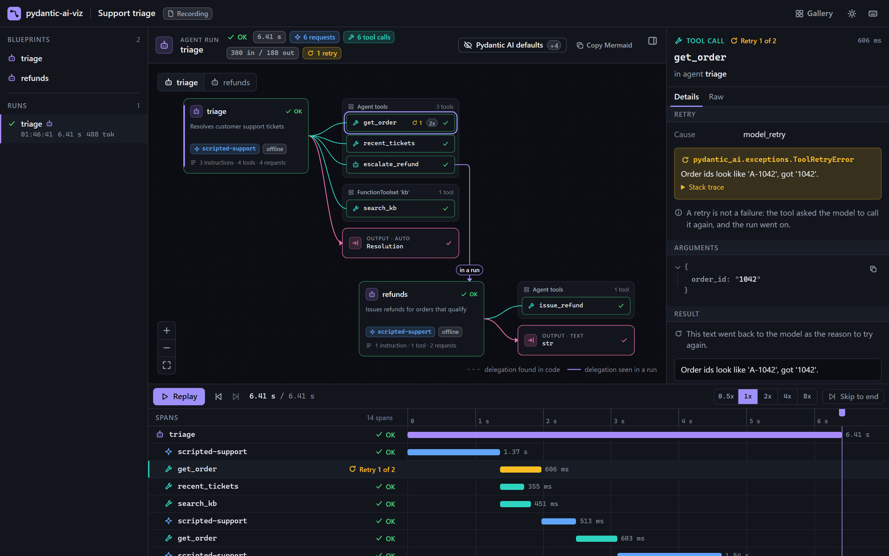
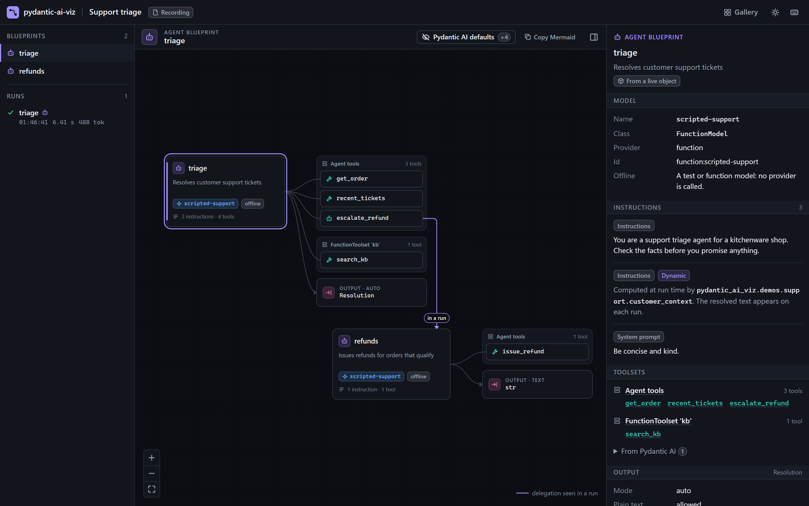
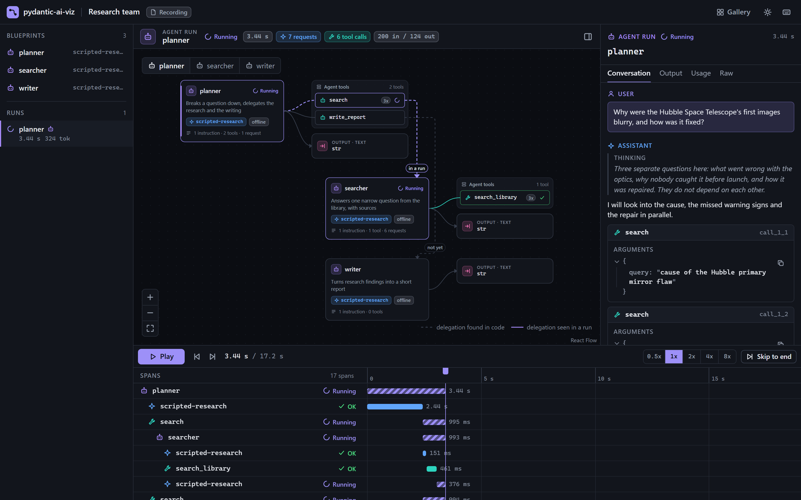
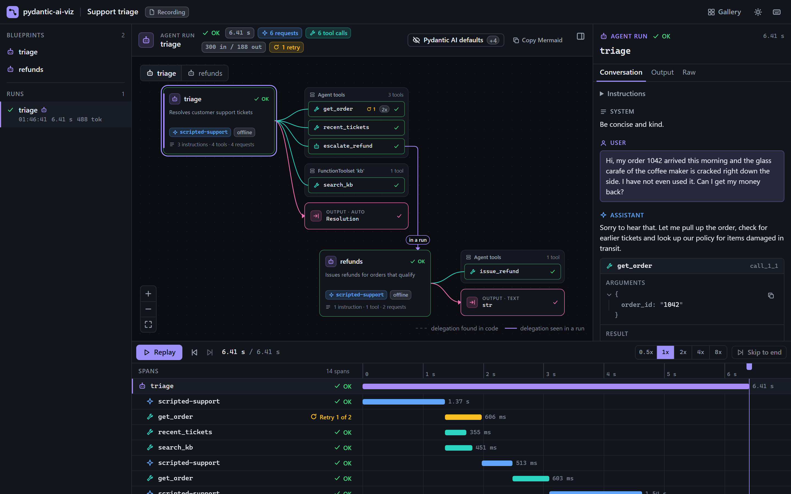
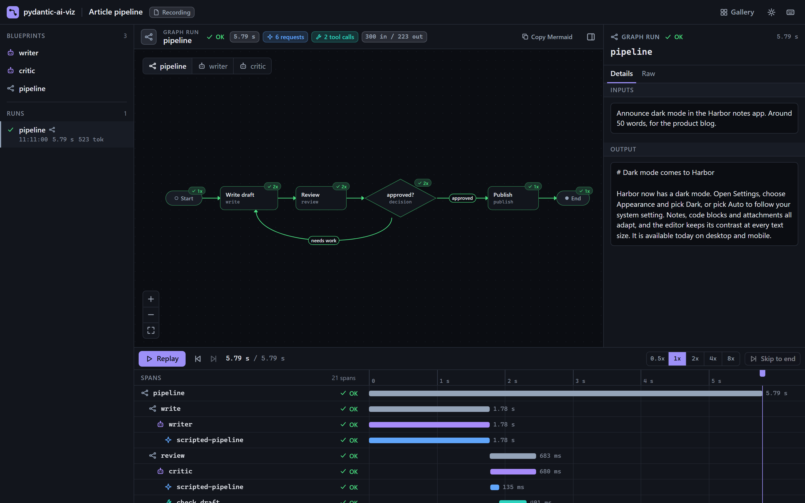

# pydantic-ai-viz

See what your [Pydantic AI](https://ai.pydantic.dev/) agents are (the blueprint) and what they do (the run) on one canvas, live or replayed. No API key, no account, nothing leaves your machine.

[](https://github.com/LowWeiLin/pydantic-ai-viz/actions/workflows/ci.yml)
[](https://pypi.org/project/pydantic-ai-viz/)
[](https://pypi.org/project/pydantic-ai-viz/)
[](https://github.com/LowWeiLin/pydantic-ai-viz/blob/main/LICENSE)

> **Unofficial.** pydantic-ai-viz is a community project. It is not affiliated with or endorsed by Pydantic.

[](https://lowweilin.github.io/pydantic-ai-viz/demo/)

The screenshot links to the [hosted demo](https://lowweilin.github.io/pydantic-ai-viz/demo/), which replays real recordings in your browser.

## Try it in 10 seconds

```bash
uvx pydantic-ai-viz demo
```

This opens a browser tab and plays a scripted support-triage agent: streamed tokens, three parallel tool calls, a retry, a delegation to a second agent and a structured result. The demo model is scripted, so it needs no API key and makes no network calls. `pydantic-ai-viz demo --list` shows the other demos.

## Use it with your agent

```bash
pip install pydantic-ai-viz    # or: uv add --dev pydantic-ai-viz
```

```python
import pydantic_ai_viz as pviz
from my_app import agent

with pviz.serve(agent, open_browser=True) as session:
    agent.run_sync("Where is my order?")
    session.wait()  # keep the viewer up until Ctrl+C
```

`serve` captures every agent run in the process from then on. You do not change how you call the agent.

Or leave your code alone and use the CLI:

```bash
# Draw the blueprint. Nothing is run and no model is called.
pydantic-ai-viz view my_app.agents:support_agent

# Run a script and watch its agent runs live.
pydantic-ai-viz run my_script.py
```

## What you get

- **Blueprint.** The agent as a diagram: model, instructions, toolsets, tools with their JSON schemas, output type and delegation to other agents. Drawn from the agent object, before anything runs.
- **Live runs.** Model requests, tool calls, retries and sub-agent runs light up on the blueprint and stack up in a span timeline as they happen.
- **Inspector.** Click any span to read the conversation, tool arguments and results, token usage and the raw span attributes.
- **Graphs.** `pydantic-graph` graphs get the same treatment: nodes, decisions and edges, with the active node highlighted during a run.
- **Recordings and exports.** Scrub back through any run. Save it as a `.pviz.jsonl` recording, or export one self-contained HTML file that opens offline.

<table>
  <tr>
    <td></td>
    <td></td>
  </tr>
  <tr>
    <td></td>
    <td></td>
  </tr>
</table>

## How it works

`serve` turns on Pydantic AI's own OpenTelemetry instrumentation and points it at a private tracer provider, so nothing is sent anywhere and no global OpenTelemetry state is set. A span processor in your process turns each span into an event in an append-only log. A small local server (standard library only, bound to `127.0.0.1`) streams that log to a one-file viewer, and the same log is what a recording or an export contains.

Read more in the [documentation](https://lowweilin.github.io/pydantic-ai-viz/):
[quickstart](https://lowweilin.github.io/pydantic-ai-viz/quickstart/) ·
[guides](https://lowweilin.github.io/pydantic-ai-viz/guides/visualize-an-agent/) ·
[Python API](https://lowweilin.github.io/pydantic-ai-viz/reference/python-api/) ·
[CLI](https://lowweilin.github.io/pydantic-ai-viz/reference/cli/)

## Limits and non-goals

- **Local development only.** It captures runs in the process that calls `serve` or `record`, and keeps them in memory. For production tracing, use [Pydantic Logfire](https://pydantic.dev/logfire). The two work together; see the [Logfire guide](https://lowweilin.github.io/pydantic-ai-viz/guides/logfire/).
- **Not a chat playground.** Pydantic AI already has `agent.to_web()` for that.
- **Recordings and exports contain your prompts, tool arguments and tool results.** Read [Privacy](https://lowweilin.github.io/pydantic-ai-viz/guides/privacy/) before you share one.
- **Token streaming is opt-in** (`stream=True`). It switches model requests to streaming, which fails on a model that cannot stream.
- **MCP toolsets are shown as one opaque node.** Their tools appear once a run has used them.
- **No cost estimates, run diffing or search** in this version.

## Compatibility

| | Supported |
|---|---|
| Python | 3.11, 3.12, 3.13, 3.14 |
| Pydantic AI | `pydantic-ai-slim>=2.60,<3` |
| OpenTelemetry SDK | `opentelemetry-sdk>=1.30` |
| OS | Windows (tested). Linux and macOS are expected to work, but had not been run when this was written. |

A few blueprint fields are read from private Pydantic AI attributes. If a Pydantic AI release changes them, those fields degrade to a warning in the viewer and the rest keeps working. The [compatibility page](https://lowweilin.github.io/pydantic-ai-viz/reference/compatibility/) lists them and says exactly which versions were tested.

## Contributing

Bug reports and pull requests are welcome. [CONTRIBUTING.md](https://github.com/LowWeiLin/pydantic-ai-viz/blob/main/CONTRIBUTING.md) covers the development setup and the checks to run. Report security issues privately as described in [SECURITY.md](https://github.com/LowWeiLin/pydantic-ai-viz/blob/main/SECURITY.md).

## Licence

[MIT](https://github.com/LowWeiLin/pydantic-ai-viz/blob/main/LICENSE).

pydantic-ai-viz is an unofficial community project. It is not affiliated with, sponsored by or endorsed by Pydantic. "Pydantic", "Pydantic AI" and "Logfire" are names of their respective owners.
