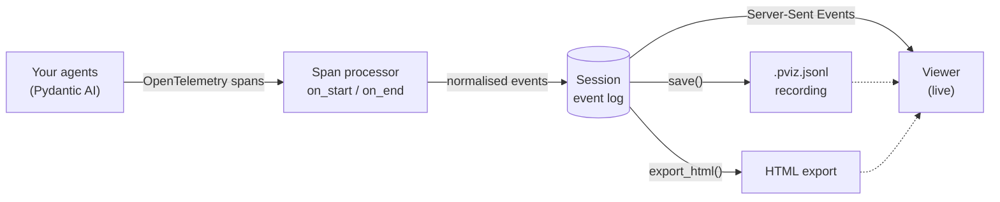

# How capture works

You do not need this page to use pydantic-ai-viz. It is here for when you want to know what the tool does to your process, why something shows up when it does, or how to build on the data.

## The pipeline



Everything left of the viewer happens inside your Python process. There is one data structure, the session's event log, and three ways to look at it. Live mode, a recording and an export are the same events delivered differently, which is why a replay looks exactly like the live session did.

## Step 1: Pydantic AI emits spans

Pydantic AI can describe every agent run as [OpenTelemetry](https://opentelemetry.io/) spans. `serve` and `record` turn that on with the public API:

```python
Agent.instrument_all(
    InstrumentationSettings(tracer_provider=private_provider, version=5, include_content=include_content)
)
```

- The setting is looked up **per run**, so it covers agents created before the call and after it.
- The tracer provider is **private** to the session. No global OpenTelemetry provider is set, nothing is exported, and other OpenTelemetry users in your process are not affected.
- The setting itself is **process-wide** and there is only one, which is why one session can be active at a time and why Logfire users take a [different route](../guides/logfire.md).

One agent run produces a small tree of spans:

```text
invoke_agent triage                  the agent run
├─ chat scripted-support             a model request
├─ execute_tool get_order            ┐
├─ execute_tool recent_tickets       ├ three tool calls from one model response
├─ execute_tool search_kb            ┘
├─ chat scripted-support
├─ execute_tool escalate_refund
│  └─ invoke_agent refunds           a delegated agent run, inside the tool that started it
│     ├─ chat scripted-support
│     └─ execute_tool issue_refund
└─ chat scripted-support
```

Three properties of this tree shape what the viewer can show:

- **Tool calls are children of the agent run, not of the model request** that asked for them. Calls made in parallel are siblings that overlap in time.
- **Delegation is parentage.** A sub-agent's run is a child of the tool call that started it. This is how a delegation edge becomes `observed`.
- **The output tool has no span.** When an agent returns structured output through `final_result`, nothing is emitted for that call, so the viewer lights the output node when the agent run ends successfully.

## Step 2: A span processor sees both ends

A normal OpenTelemetry exporter receives a span when it **ends**. A viewer that waited for that would show a ten-second tool call only after it finished, and an agent run only when it was all over. So pydantic-ai-viz registers a span processor and uses both of its callbacks:

| Callback | Event | What is known |
|---|---|---|
| `on_start` | `span.started` | Name, parent, start time, agent name, run id. For a tool call: tool name, call id and **arguments**. For a model request: the model name. |
| `on_end` | `span.ended` | Everything: status, duration, messages, instructions, token usage, tool result, final output, any error. |

This is the reason for the "available at start" and "available at end" split you see throughout the viewer. A running tool shows its arguments but no result; a running model request shows no messages yet. The information does not exist until the span ends.

Each `span.ended` event carries the **whole** span again, so the viewer simply replaces what it had. A viewer that connects halfway through a run, or loses a `span.started`, still ends up correct.

The processor never raises into your code. Every callback is wrapped; if something goes wrong while handling a span, it is counted and reported once on stderr, and your agent run continues untouched.

## Step 3: Spans are normalised

Raw span attributes are not shown as they are. They are named after OpenTelemetry's GenAI conventions (`gen_ai.tool.call.arguments`, `gen_ai.usage.input_tokens`, ...), several hold JSON inside strings, and details differ between Pydantic AI's instrumentation versions. One Python module turns each span into a small, typed structure:

| Span | Becomes | With |
|---|---|---|
| `invoke_agent <agent>` | `agent_run` | output, conversation, usage |
| `chat <model>` | `model_request` | input and output messages, instructions, settings, usage |
| `execute_tool <tool>` | `tool_call` | arguments, result, retry information |
| anything else | `other` | its raw attributes |

Because all of this happens in Python, the viewer never interprets a raw attribute, and a recording made today stays readable when attribute names change in a later Pydantic AI release. Attributes that were not given a structured home are kept and shown in the inspector's **Raw** tab. The exact mapping is in the [wire format reference](../reference/wire-format.md#normalisation).

## Step 4: The event log

A [`Session`](../reference/python-api.md#session) is an append-only list of events. Each has a sequence number and a timestamp.

| Event | Meaning |
|---|---|
| `session.started` | Always first. Versions, title, whether content and streaming are on. |
| `blueprint.agent`, `blueprint.graph` | A blueprint, new or updated. The latest one with a given `id` wins. |
| `span.started`, `span.ended` | A step of a run began or finished. |
| `stream.delta` | A piece of streamed text, only with [`stream=True`](../guides/token-streaming.md). |

Blueprint events are produced at registration and again whenever a run teaches the session something new: a name, the tools of an opaque toolset, a delegation that really happened. That logic lives in the session, so the viewer just draws the latest blueprint.

The log is bounded. Past `max_events`, the oldest finished runs are dropped whole; `session.started` and blueprints are never dropped.

## Step 5: The viewer is a function of the log

The viewer keeps no state of its own beyond the events it has received. It folds them into a picture: blueprints by id, spans by span id, streamed text by span.

- **Live:** the local server streams the log over Server-Sent Events. A new browser tab gets every retained event and then follows along. After a dropped connection the browser asks for everything after the last event it saw.
- **Recording or export:** the same events are read from a file or from inside the HTML page.

**Going back in time is a projection, not a replay.** Every span has a start and an end time, so "the state at time *t*" can be computed directly: a span is visible if it had started by *t*, and still running if it had not ended by *t*. Scrubbing is therefore instant, in either direction, on a run of any length.

## Why token totals come from model requests

Token counts are reported in several places, and they do not all mean the same thing once agents delegate. Take a parent agent whose tool runs a sub-agent the recommended way, with `usage=ctx.usage`. Measured on Pydantic AI 2.70:

| Number | Value | Covers |
|---|---|---|
| `result.usage.input_tokens` of the parent | 319 | The parent's requests **and** the sub-agent's |
| Usage on the parent's `agent_run` span | 212 | The parent's own requests |
| Usage on the sub-agent's `agent_run` span | 107 | The sub-agent's own requests |

Add the first number to the third and the sub-agent is counted twice. Whether a run-level number includes sub-agents also depends on whether the tool passed `usage=ctx.usage` at all, which the viewer cannot know.

Model requests have no such ambiguity. Every token is spent in exactly one model request, and each `model_request` span reports only its own. So the rule is:

> A run's token total is the sum of usage over all `model_request` spans in the run.

That is what the sidebar and the Usage tabs show. The usage on an individual agent run in the inspector is that agent's own model requests, without its sub-agents.

## Graphs take a different path

`pydantic-graph` does not emit plain OpenTelemetry spans; it reports through Logfire only. So for graphs, pydantic-ai-viz produces the spans itself. [`run_graph`](../guides/graphs.md) drives the graph with its public `graph.iter(...)` API, opens a `graph_run` span around the whole execution and a `graph_node` span around each task, on the session's own tracer provider. From there on they travel the same pipeline as agent spans, and agent runs started inside a step nest under it as ordinary child spans.

## Token streaming takes a side channel

Spans never contain single tokens. With `stream=True`, an event listener registered through `agent.on_event(...)` receives Pydantic AI's part-start and part-delta events and appends `stream.delta` events to the log. Each delta is tied to the model request that is currently open for that agent run, so the text lands on the right span. The price of this side channel is described in [Token streaming](../guides/token-streaming.md).

## What is not captured

- Runs in other processes.
- Agents that carry their own instrumentation setting (`agent.instrument = ...`, an `Instrumentation` capability or an `InstrumentedModel`), which overrides the process-wide one. See [Troubleshooting](../troubleshooting.md#an-agent-sets-its-own-instrumentation).
- Anything Pydantic AI does not put in a span: time spent inside your tool is the tool span's duration, but what the tool did internally is invisible unless it runs an agent.
