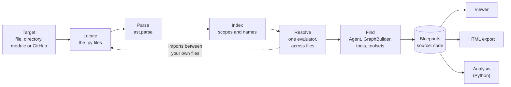

# How view works

`pydantic-ai-viz view` draws your agents and graphs **from their source code**. The files are read as text and parsed with Python's own parser. They are never imported and never executed. [`pviz.analyze(...)`](../reference/python-api.md#analyze) does the same from Python and returns the blueprints as data.

You do not need this page to use `view`. It is here for when you want to know what was read, why a value shows up as code instead of a value, or whether it is safe to point `view` at a repository you have not reviewed.

Three consequences are worth knowing first:

- **Nothing in the code runs.** Not the top-level code, not a decorator, not a default argument, not an `import`. Pointing `view` at code is as safe as opening it in an editor.
- **Nothing the code imports has to be installed.** A file that starts with `from dotenv import load_dotenv` is read the same whether or not `python-dotenv` is there. Providers, API keys and environment variables do not matter either.
- **Only what the source spells out is known.** `Agent("openai:gpt-5.2")` names its model. `Agent(get_model())` does not, unless `get_model` returns a value written in your code, and otherwise the viewer shows the expression `get_model()` instead of pretending to know what it returns.

The rule behind the third point runs through the whole analyser: **a value is reported when the source states it, and the source text is reported when the source computes it. Nothing is guessed.**

<figure class="screenshot" markdown="span">
  
  <figcaption><code>pydantic-ai-viz view src/pydantic_ai_viz/demos</code>. Every part says where it is defined; the edge from <code>escalate_refund</code> to <code>refunds</code> was found by reading the tool's code.</figcaption>
</figure>

## The pipeline



1. **Locate.** The [target](../reference/cli.md#targets) becomes a list of `.py` files: one file, every file below a directory, the file of a module name, or a GitHub repository fetched with `git`. Nothing is imported to find a module: its file is looked for on disk.
2. **Parse.** Each file is decoded the way Python decodes source (UTF-8, or the encoding the file declares) and handed to the standard-library [`ast`](https://docs.python.org/3/library/ast.html) module, which produces a syntax tree. Parsing is not running: no statement is evaluated. A file that is too large, cannot be decoded or is not valid Python is skipped, and the reason becomes a notice.
3. **Index.** The tree is walked once to record which names each scope binds: assignments, `def`, `class` and imports, per module, function and class body. A name that only running the code could give a value, such as a loop variable or a function parameter, is recorded as unknown.
4. **Resolve.** Whenever the analyser needs to know what an expression stands for, one general evaluator follows it through the code (next section). An import of one of your own files pulls that file in, so the evaluator can follow a name into it.
5. **Find.** Every call of Pydantic AI's `Agent`, and of pydantic-graph's `GraphBuilder` or `Graph(nodes=[...])`, is a blueprint. A call counts only when its name can be traced to an import from `pydantic_ai` or `pydantic_graph`: a class of your own that happens to be called `Agent` is not an agent. Decorators and registration calls (`@agent.tool`, `@agent.instructions`, `toolset.add_function(f)`, `builder.add(...)`) are traced back to the construction they belong to.
6. **Describe.** Each argument becomes a value when the evaluator can read it, and source text when it cannot.

Every blueprint made this way has `source: "code"` (see [the three provenances](blueprint-vs-run.md#three-ways-to-get-a-blueprint)), and everything in it carries the file and line it was found at, so the viewer can say "Defined at `agents.py:42`".

## How values are resolved

The analyser knows two kinds of things, and keeps them apart.

**What Pydantic AI means.** The public API of `pydantic_ai` and `pydantic_graph`, and the parts of `pydantic`, `dataclasses` and `typing` that define types: what each `Agent` argument is, what `@agent.tool` and `Tool(...)` register, which classes are toolsets and output markers, how `GraphBuilder` numbers its nodes, how a `BaseModel` or a `TypedDict` becomes a JSON Schema. This is the only library knowledge in the analyser.

**What Python means.** Everything else is read by one evaluator of the language, the same way for every project, whatever its coding style:

| It follows | For example |
|---|---|
| Names, assignments and unpacking | `MODEL = "openai:gpt-5.2"`, `FAST, DEEP = "gpt-5-mini", "gpt-5.2"` |
| Imports and re-exports between your files | `from app.config import MODEL`, a name re-exported by a package's `__init__.py`, `from .tools import *` |
| Attributes of modules, classes and instances | `config.MODEL`, `Settings.model`, `self.config.model` where `self.config = Config()` |
| Return values of your own functions and methods | `def default_model(): return "openai:gpt-5.2"` |
| Strings built from known parts | `"openai:" + NAME`, `f"{PROVIDER}:{NAME}"` |
| Items of containers written in the source | `MODELS["fast"]`, `TIERS[1]` |
| Arguments passed as `**kwargs` from a written-out dict | `Agent(MODEL, **COMMON)` with `COMMON = {"retries": 2}` |
| Loops over a written-out sequence | `for tool in [search, fetch]: agent.tool_plain(tool)` |
| Inheritance | an agent made in a base class's `__init__` and given tools by a derived class |

For instance, in

```python
PROVIDER = "anthropic"
MODELS = {"fast": f"{PROVIDER}:claude-haiku-5", "deep": f"{PROVIDER}:claude-opus-5"}


class Config:
    model = MODELS["deep"]


agent = Agent(Config().model)
```

the model is read as `anthropic:claude-opus-5`, with no warning.

The evaluator stops where the value stops being written in your code:

- **A function's parameters are unknown inside it.** `def make(name): return "openai:" + name` is not followed for a call `make("gpt-5.2")`; the model is the expression `make("gpt-5.2")`.
- **A name assigned in more than one place**, for example in both branches of an `if`, is not taken for its last value. Which value it holds is decided when the code runs, so a model held by such a name is shown as the name, and tools collected that way come with a warning that some of them depend on a condition.
- **Anything from outside your code is never evaluated.** See the next section.

## What shows as decided at run time, and why

A value that depends on something outside the files that were read cannot be known by reading them:

- environment variables (`os.getenv("MODEL", "openai:gpt-5.2")`, `os.environ[...]`),
- configuration files, command-line arguments and the network,
- what a function of the standard library or of another installed package returns (`load_config()["model"]`, `dedent("""...""")`),
- settings classes that fill themselves in from the environment.

None of these is evaluated, whichever library it comes from, and **no default is taken from them**: `Agent(os.getenv("MODEL", "openai:gpt-5.2"))` shows the expression `os.getenv("MODEL", "openai:gpt-5.2")`, not `gpt-5.2`, because the environment may well say otherwise. A default is a guess about the machine the code will run on, and a picture that shows a guess as a fact is worse than one that says "not known here".

Every such value is reported in the same three ways, with the same wording whatever produced it:

- the field holds the **source text** of the expression, exactly as written (an instruction keeps its line breaks), and the viewer marks it **decided at run time**;
- the blueprint's `warnings` list says so in one plain sentence, for example "the model is set by `get_model()`, so it is only known when the code runs";
- `view` prints how many such warnings there were.

Other things that stay open:

- **An instruction function** (`@agent.instructions`, or a function passed in `instructions=[...]`) is listed by name and marked dynamic. An f-string with unknown parts is shown as its template, `{today}` left in place.
- **Pydantic AI's defaults.** A setting the source does not mention stays empty. The analyser does not fill in what the installed Pydantic AI would use, because the code may be written for another version.
- **Tools of MCP servers and dynamic toolsets.** They exist only once the server or the code is running. The toolset is one placeholder node, and its tools appear once a run uses them.
- **Types from installed packages.** An output type defined in another package has no schema; its name is shown.
- **Graph edges added in a loop or by a helper function.** The steps are listed, the edges that are written out are drawn, and a warning names the call that could not be followed.
- **Agents that the source does not construct**: an agent returned by a library function, an `Agent` subclass, `Agent.from_spec(...)`. They are not found. Use [`--import`](#when-to-use-import) for these.

Because the code is read and not run, it does not have to match the Pydantic AI you have installed. Arguments that earlier releases took are read as what they became: `result_type` as the output type, `mcp_servers` as toolsets, `builtin_tools` as native tools, and `Graph(nodes=[...])` as a graph.

## Across files

A real project spreads an agent over several files: the model in `config.py`, the tools in `tools.py`, the output model in `models.py`. `view` follows the imports between your own files, whichever target you give it:

| Target | What is read | Blueprints shown |
|---|---|---|
| `app/agents.py` | that file, and the files of your project it imports, and theirs | the agents and graphs of `app/agents.py` |
| `app/agents.py:support` | the same | `support` and the agents it delegates to |
| `app/` | every `.py` file below `app/`, and the files they import | everything in those files |
| `app.agents` | the file of that module, found on disk | as for its file |
| `gh:owner/repo@ref/subdir` | that part of the repository, fetched with git | as for a directory |

A file that is read only because another one imports it contributes its definitions, not blueprints of its own. Viewing `app/agents.py` shows the agents of that file, with tools, toolsets, output models and delegates from wherever they are defined. An agent in `app/config.py` is shown only if `app/agents.py` imports it by name, or one of its agents delegates to it.

An import is looked up the way Python would look it up from the importing file: relative imports from its package, absolute ones from the directories above it up to the **project root**. The project root is the nearest directory above the target that holds a project file (`pyproject.toml`, `setup.py`, `setup.cfg`, `requirements.txt`, a lock file, or `.git`), or the directory above the outermost package when there is none. A `src` layout works. Imports never leave the project: installed packages, virtual environments and `site-packages` are never opened, even when a copy of a package lies inside the project.

Run this to see it on the demos that ship with pydantic-ai-viz, three files with seven agents and a graph:

```bash
pydantic-ai-viz view src/pydantic_ai_viz/demos
```

The same blueprints are on the [hosted demo](https://lowweilin.github.io/pydantic-ai-viz/demo/?src=recordings/source.pviz.jsonl), and the [real-world examples](../real-world.md) show `view` on twelve public projects.

## Limits

The analyser is written to be pointed at code nobody has reviewed, so all of its work is bounded:

| Limit | Default | When it is reached |
|---|---|---|
| Size of one file | 2 MB | the file is skipped, with a notice |
| Files read, targets and imports together | 2,000 | the rest is not read, with a notice |
| Time for the analysis | 30 seconds | what was found so far is shown, with a notice |
| Time for fetching a GitHub repository | 300 seconds | `view` stops with an error |

All four can be changed through [`Limits`](../reference/python-api.md#limits) when you call `analyze`. Every other walk is bounded too: following names, opening nested types, expanding lists. Cyclic imports, aliases that refer to themselves and models that contain themselves end in a warning, and a file nested too deeply for Python's parser is skipped. None of these is ever a crash.

## When to use `--import`

```bash
pydantic-ai-viz view --import my_app.agents:support_agent
```

`--import` loads the target and reads the live `Agent` and `Graph` objects, as [`pviz.blueprint(obj)`](../reference/python-api.md#blueprint) does. Nothing is left open: computed models and tools, Pydantic AI's defaults, and schemas exactly as the model is sent them.

| | `view TARGET` | `view --import TARGET` |
|---|---|---|
| Runs the target's code | Never | Yes, on import |
| Needs the target's dependencies | No | Yes |
| Computed values such as `get_model()` | Shown as the expression | Resolved |
| Pydantic AI defaults | Not shown | Shown |
| Agents made by a library or a subclass | Not found | Found, if bound to a top-level name |
| Source locations | Yes | No |
| Works on a GitHub target | Yes | Refused |
| A blueprint's `source` | `"code"` | `"object"` |

Use `view` first. Reach for `--import` when the source leaves too much open and the code is your own, installed in the environment you run the command from.

!!! warning "`--import` executes the target"

    Importing a module runs its top-level code and the top-level code of everything it imports. Use `--import` only on code you trust, in an environment where its dependencies are installed.

Whichever way a blueprint was made, runs are drawn on it the same way when you later [watch a run](../guides/live-runs.md).

## Pointing it at code you do not trust

`view` is safe to run on a repository you have not read, which is what it is for when you review someone else's agent.

- **No code of the target runs.** The analyser contains no `eval`, no `exec`, no `compile` of the target and no import of it. Literal values are read by a small reader of its own that counts what it visits, not by `ast.literal_eval`. A test in the repository fails if any of these appears in the analyser.
- **No process is started**, except `git` to fetch a GitHub target.
- **Nothing outside the project is read.** Imports are followed only inside the [project root](#across-files), and never through a symbolic link or a junction, which could lead anywhere on the disk. A file you name as a target is read wherever it is.
- **Hostile input ends in a notice, not a hang or a crash**: huge files, deep nesting, import cycles and bytes that are not text are covered by the limits above.
- **A GitHub target is fetched, never built.** `git` fetches one commit, without history, into a fresh repository in the cache directory, writes out only `.py` files and the few files that mark where a project starts, writes symbolic links as plain files, and removes its own `.git` directory afterwards. No hook, build step or setup script of the repository runs, and `--import` is refused for it. Fetching uses the network and your git configuration; the fetched files stay in the cache (`PYDANTIC_AI_VIZ_CACHE_DIR`, or your user cache directory) until you delete them.
- **The viewer shows source text as text.** A prompt or an expression that contains HTML or script is displayed, never interpreted.

What `view` cannot protect you from is the next step: running the code. `pydantic-ai-viz run`, `view --import` and your own `python` execute it. See the [security policy](https://github.com/LowWeiLin/pydantic-ai-viz/blob/main/SECURITY.md).
