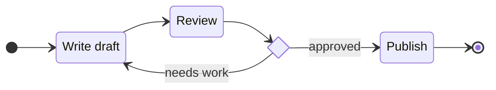

# Demos

Three demos ship with the package. Each is a small but complete agent program whose "model" is a script: it returns the same responses every time, needs no API key and makes no network calls. Everything else is real. The agents are ordinary Pydantic AI agents, the tools are ordinary functions that really run, and the spans you see are the ones Pydantic AI emits.

```bash
pydantic-ai-viz demo --list
```

```text
support - A triage agent resolves a damaged-order ticket: parallel tools, a retry, a delegated refund.
research - A planner fans out to three parallel searchers, then a writer drafts the report.
pipeline - A step graph writes, reviews and publishes a post, looping back once for a rewrite.
```

You can also watch all three in the [hosted demo](https://lowweilin.github.io/pydantic-ai-viz/demo/), which replays recordings of these same scenarios in your browser. The hosted demo also shows [the demos' source code as `view` reads it](https://lowweilin.github.io/pydantic-ai-viz/demo/?src=recordings/source.pviz.jsonl): seven agents and a graph in three files, drawn without running any of them.

## support { #support }

```bash
pydantic-ai-viz demo            # support is the default
```

[Open the recording in the hosted demo](https://lowweilin.github.io/pydantic-ai-viz/demo/?src=recordings/support.pviz.jsonl)

A customer writes that the coffee maker from order 1042 arrived cracked. The `triage` agent has to check the facts, arrange a refund and reply.

| Agent | Has |
|---|---|
| `triage` | Dependencies, one static and one dynamic instruction, a system prompt, three tools of its own (`get_order`, `recent_tickets`, `escalate_refund`), a `kb` toolset with `search_kb`, and a structured output type, `Resolution` |
| `refunds` | One tool, `issue_refund` |

What to watch for:

1. **Streaming.** The first response arrives word by word, followed by the arguments of three tool calls.
2. **Parallel tool calls.** `get_order`, `recent_tickets` and `search_kb` start together and appear as overlapping siblings in the timeline.
3. **A retry.** The model asked for order `1042`; the tool wants `A-1042` and raises `ModelRetry`. The `get_order` node turns amber, the model corrects itself, and the second attempt succeeds. Select the first attempt: the **Retry** section at the top of its **Details** tab shows the message the model was given.
4. **Delegation.** `escalate_refund` runs the `refunds` agent. Before the run, the edge between them is dashed, because it was only read from the code. When the delegation happens it turns solid. The `refunds` run is nested under the tool call in the timeline.
5. **Structured output.** The run ends with a `Resolution`. The output node lights up; select it to see the schema, or select the agent run to see the value.
6. **Token totals.** `refunds` is called with `usage=ctx.usage`. The run total still counts every token once.

Then scrub back to the start and press ++space++ to watch it again at your own pace.

## research { #research }

```bash
pydantic-ai-viz demo research
```

[Open the recording in the hosted demo](https://lowweilin.github.io/pydantic-ai-viz/demo/?src=recordings/research.pviz.jsonl)

A `planner` agent is asked why the Hubble Space Telescope's first images were blurry and how it was fixed. It splits the question in three, sends each part to a `searcher` agent at the same time, then hands the findings to a `writer` agent and returns the report as plain text.

What to watch for:

1. **One sub-agent, three concurrent runs.** The `search` tool is called three times in one model response. Each call starts its own `searcher` run, and the three run side by side in the timeline.
2. **A multi-agent canvas.** `planner`, `searcher` and `writer` are all drawn, joined by delegation edges. Use the switcher above the canvas to look at the run from each agent's point of view.
3. **Thinking.** The planner's first response starts with a thinking part, shown apart from the text.
4. **Text output.** There is no output tool here; the output node shows `str`.
5. **Token totals across four sub-agent runs,** again without double counting.

## pipeline { #pipeline }

```bash
pydantic-ai-viz demo pipeline
```

[Open the recording in the hosted demo](https://lowweilin.github.io/pydantic-ai-viz/demo/?src=recordings/pipeline.pviz.jsonl)

A `pydantic-graph` step graph that writes a short product announcement:



The `write` step runs a `writer` agent and the `review` step runs a `critic` agent. The first draft is full of buzzwords, so the critic sends it back once. The second draft passes and is published.

What to watch for:

1. **A graph blueprint.** Steps as cards, the decision as a diamond with its note, "approved?", and a labelled edge per branch.
2. **The active node.** Each node is highlighted while it runs.
3. **A loop.** `write` and `review` are each visited twice, and show a visit count.
4. **Agents inside steps.** In the timeline, each `writer` and `critic` run is nested under the graph node that started it. Select one to read the conversation, including the critic's `check_draft` tool call.
5. **Follow-up turns.** The second `writer` run continues the first one's conversation, with the reviewer's feedback as the new prompt.

The scenario is driven by [`run_graph`](guides/graphs.md), which is what makes the graph's own nodes show up.

## Options

```bash
pydantic-ai-viz demo research --speed 2         # twice as fast
pydantic-ai-viz demo support --speed 0          # no delays at all
pydantic-ai-viz demo pipeline --port 9000 --no-open
pydantic-ai-viz demo support --record support.pviz.jsonl --export support.html
```

With `--record` or `--export` the scenario is played once without a server and the files are written. All flags are in the [CLI reference](reference/cli.md#demo).

While a demo is being served, **Run again** in the viewer's top bar plays the scenario once more as a new run.

## Read the source

The demos are meant to be read. They are 180 to 300 lines each, in [`src/pydantic_ai_viz/demos/`](https://github.com/LowWeiLin/pydantic-ai-viz/tree/main/src/pydantic_ai_viz/demos):

| File | Contents |
|---|---|
| `support.py`, `research.py`, `pipeline.py` | The agents, tools and graph of each demo |
| `_script.py` | The helper that turns a list of scripted turns into a `FunctionModel` that can also stream |

Shorter starting points are in [`examples/`](https://github.com/LowWeiLin/pydantic-ai-viz/tree/main/examples).

## About the model names

The demo models are called `scripted-support`, `scripted-research` and `scripted-pipeline`, and the viewer marks them **offline**. They are Pydantic AI `FunctionModel`s. The names are deliberately honest: nothing in a demo recording was produced by a real language model.
