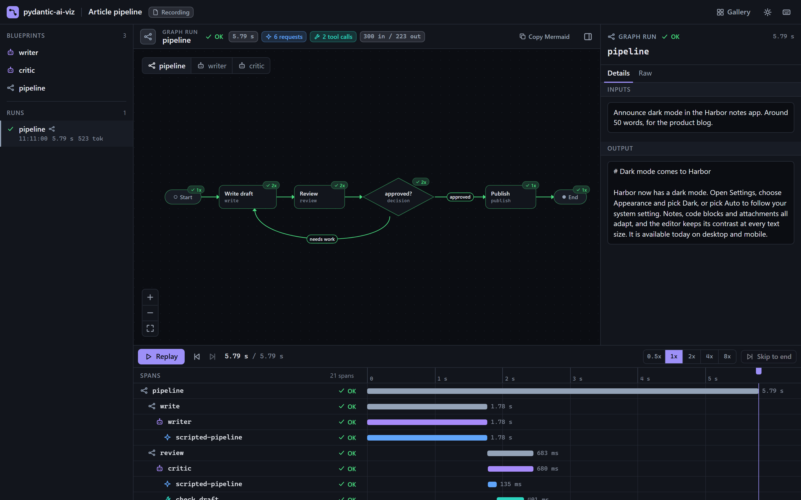

# Graphs

pydantic-ai-viz draws [`pydantic-graph`](https://ai.pydantic.dev/graph/) graphs built with `GraphBuilder`: the blueprint without running anything, and the active node during a run.

<figure class="screenshot" markdown="span">
  
</figure>

## Draw a graph

A graph is a target like an agent is:

```bash
pydantic-ai-viz view my_app.pipeline:graph
```

```python
import pydantic_ai_viz as pviz
from my_app.pipeline import graph

bp = pviz.blueprint(graph)  # a GraphBlueprint
print([node.id for node in bp.nodes])
print(bp.mermaid)  # the same text as graph.render(direction="LR")
```

On the canvas:

| Shape | Node |
|---|---|
| Pill | Start and end |
| Card | A step, with its label if it has one |
| Diamond | A decision, with its note (for example "approved?") |
| Labelled edge | A decision branch, with the branch label |

Joins, broadcasts and maps are drawn as cards with their kind. The **Copy Mermaid** button copies the `stateDiagram-v2` text, ready to paste into a README or a pull request.

## Watch a graph run

Agent runs are captured without touching your code. Graph runs are different: `pydantic-graph` reports its own progress only through Logfire, so there is nothing for a plain OpenTelemetry processor to pick up. To see graph nodes light up, change the one line that runs the graph:

```python
import pydantic_ai_viz as pviz
from my_app.pipeline import Draft, graph

pviz.serve(graph, open_browser=True)

# before: output = await graph.run(state=Draft(), inputs="Announce dark mode")
output = await pviz.run_graph(graph, state=Draft(), inputs="Announce dark mode")
```

[`run_graph`](../reference/python-api.md#run_graph) takes the same `state`, `deps` and `inputs` as `graph.run` and returns the graph's output. While it runs:

- the graph run is the root of a new run in the sidebar,
- each node the graph executes is highlighted and gets a row in the timeline, with its inputs,
- a node that is visited again (a loop) shows a visit count,
- agent runs started inside a step are nested under that step, so you can open a node and read the conversation that happened in it.

If the graph raises, the graph run is marked as an error and the exception is raised to you unchanged.

### `run_graph` is safe to leave in

`run_graph` looks for a session in this order: the `session=` argument, then the active session, and if there is neither it simply calls `graph.run(...)`. Code that uses it behaves the same in production, where no session exists, as it did before.

```python
async def run_pipeline(brief: str) -> str:
    return await pviz.run_graph(graph, state=Draft(), inputs=brief)
```

The graph is registered with the session the first time it runs, so passing it to `serve` is optional. Passing it just makes the blueprint visible before the first run.

Give the graph a name (`GraphBuilder(name="pipeline", ...)`). An unnamed graph is labelled with its variable name when it was found in a module or file, and `graph-1`, `graph-2`, ... otherwise; `run_graph` does not let `pydantic-graph` guess a name from the calling code.

## Limit: parallel steps

When a graph runs several steps at once (after a broadcast or a map), agent runs started in those steps are shown under the **graph run**, not under the step that started them.

The reason is how nesting works. A span becomes the parent of what happens next by being the "current" span, and there can only be one current span at a time on the task that drives the graph. With one step running, pydantic-ai-viz makes that step's span current, and agent runs inside it nest correctly. With several steps running at once, no single one of them can be current, so their agent runs attach one level up.

Nothing is lost: every node still gets its row and every agent run is still captured with its full detail. Only the indentation in the timeline is coarser for parallel batches. Sequential graphs, including ones with decisions and loops, nest exactly.

## Other things to know

- **Only `run_graph` produces graph spans.** A plain `graph.run(...)` still shows the agent runs inside it, as separate runs, but no graph nodes.
- **Node inputs and the graph output are captured as JSON.** Values that are not JSON-serialisable are shown as their `repr`. With `include_content=False` they are left out.
- **If you already send graph spans to Logfire,** those are Logfire's own spans. In the viewer they appear as plain rows, not as graph nodes. See [Use with Logfire](logfire.md).
- The `pipeline` [demo](../demos.md#pipeline) is a graph with a review loop and an agent inside each step: `pydantic-ai-viz demo pipeline`.
