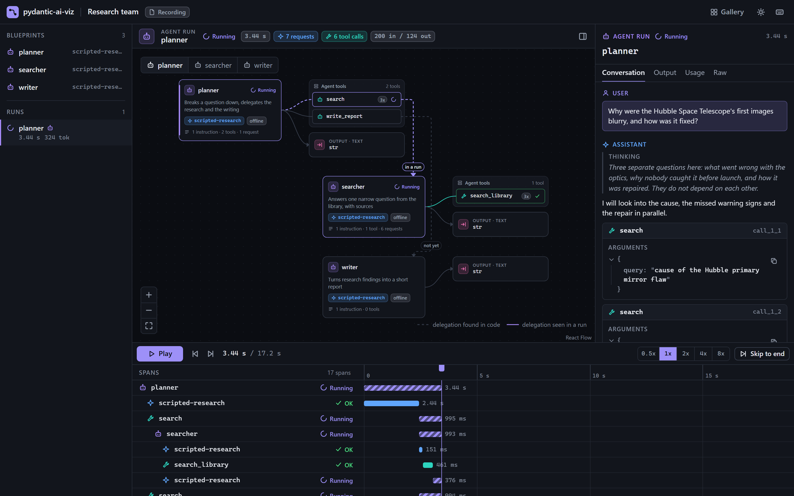
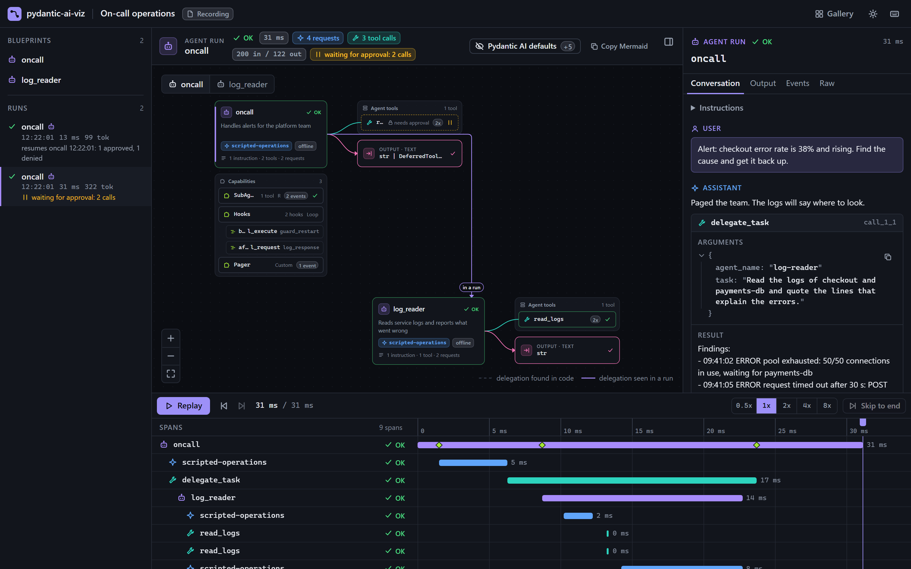
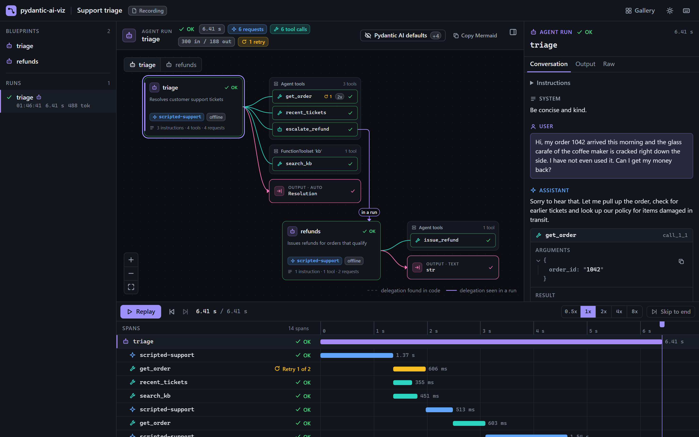

# Watch live runs

A **run** is one top-level agent run (or graph run) and everything that happens inside it: model requests, tool calls, retries and the runs of any agents it delegates to. pydantic-ai-viz captures runs in the process where your agents execute and draws them on the blueprint as they happen.

You do not wrap your agent or change how you call it. You start a session; from then on every agent run in the process is captured.

<figure class="screenshot" markdown="span">
  
</figure>

## Start a session

=== "In your code"

    ```python
    import pydantic_ai_viz as pviz
    from my_app.agents import support_agent

    session = pviz.serve(support_agent, open_browser=True)
    print(session.url)  # http://127.0.0.1:8765

    result = support_agent.run_sync("Where is my order?")

    session.wait()  # block until Ctrl+C so you can look around
    session.close()
    ```

    [`serve`](../reference/python-api.md#serve) returns at once. The server runs in a background thread, so the rest of your program carries on, sync or async. A [`Session`](../reference/python-api.md#session) is also a context manager that closes itself:

    ```python
    with pviz.serve(support_agent) as session:
        ...
    ```

=== "From the command line"

    ```bash
    pydantic-ai-viz run my_script.py --customer 42
    ```

    `run` starts a session, then executes `my_script.py` as `python my_script.py --customer 42` would (everything after the script path is passed to the script). When the script ends, the agents and graphs it defined at the top level are added as blueprints and the viewer stays up until you press ++ctrl+c++. If the script raises, the traceback is printed and the viewer stays up, so you can see what led to the failure.

    Options go **before** the script path:

    ```bash
    pydantic-ai-viz run --stream --port 9000 --no-open my_script.py
    ```

    All flags are in the [CLI reference](../reference/cli.md#run).

## What you pass to `serve`

The positional arguments are **targets**: the things you want drawn before any run happens.

| Target | Effect |
|---|---|
| An `Agent` | Its blueprint is drawn. Agents it delegates to, as far as the code shows, are drawn too. |
| A `Graph` | Its graph blueprint is drawn. |
| A module | Every agent and graph defined at the top level of the module is drawn. |
| Nothing | The canvas starts empty and fills in as agents run. |

Targets only decide what is drawn up front. **Capture is process-wide either way:** an agent you did not pass still shows up when it first runs, with a blueprint built from what the run reveals. [Blueprint vs run](../concepts/blueprint-vs-run.md) explains the difference in detail.

You can add targets later with `session.register(...)`. Registering the same object twice does nothing.

The keyword arguments:

| Argument | Default | Meaning |
|---|---|---|
| `host` | `"127.0.0.1"` | Address to bind. Anything other than loopback exposes your prompts to the network; see [Privacy](privacy.md). |
| `port` | `8765` | Port to bind. If it is busy, a free port is chosen instead. `0` always picks a free port. Read the real address from `session.url`. |
| `open_browser` | `False` | Open the viewer in your default browser. |
| `include_content` | `True` | Capture prompts, tool arguments and results. `False` keeps structure, timing and token counts only. |
| `stream` | `False` | Show tokens as they arrive. Read [Token streaming](token-streaming.md) before turning it on. |
| `instrument` | `True` | Turn on Pydantic AI's instrumentation for you. Set `False` if you configure it yourself; see [Use with Logfire](logfire.md). |
| `title` | `None` | Shown in the viewer's top bar and used as the file name of downloads. |
| `max_events` | `50_000` | Size of the in-memory event log. See [Long sessions](#long-sessions). |

## What appears, and when

Each step of a run is a span. The viewer learns about a span twice: when it starts and when it ends. That is why some details show up immediately and others only when a step finishes.

| Moment | What you see |
|---|---|
| An agent run starts | A new entry under **Runs** in the sidebar. The agent's card is marked running. |
| A model request starts | The model chip on the agent card pulses. A row appears in the timeline with the model name. With `stream=True`, the response text fills in token by token. |
| A model request ends | The full response, the input messages, the resolved instructions and the token usage of that request. |
| A tool call starts | The tool node is marked running, and its **arguments** are already available. Tool calls made in the same model response appear as siblings in the timeline, overlapping in time. |
| A tool call ends | The result. If the tool raised `ModelRetry`, the node turns **amber** and shows the attempt number; the next attempt is a new row. A tool that fails for good is **red**. |
| A tool runs another agent | A nested agent run appears under the tool call, and the delegation edge on the canvas turns from dashed to solid. |
| The agent run ends | The final output, the whole conversation, and the run's own token usage. On success the output node lights up. |

Two details that are easy to trip over:

- **The output tool has no row of its own.** When an agent returns structured output through a tool such as `final_result`, Pydantic AI does not emit a span for that call. The viewer lights the output node when the run ends successfully, and the call is visible in the conversation.
- **Amber is a retry, red is an error.** A `ModelRetry` is the agent working as designed, so it never shows red.
- **A retry from an output validator leaves no mark.** Pydantic AI records no span or attribute when an `@agent.output_validator` raises `ModelRetry`, so the viewer cannot show it; the extra model request is all a run shows. A retry from an output function or an output tool is shown as any tool retry.

## Approvals and events

A run that calls a tool needing approval, or a tool that raises `ApprovalRequired` or `CallDeferred`, ends with `DeferredToolRequests` instead of running the call. The sidebar marks it "waiting for approval" with the number of calls, the tool's node shows that it is waiting, and the run's panel lists what it waits for. When your code answers with `deferred_tool_results` on the same `message_history`, the new run is linked to it: "resumes oncall 12:05:09: 1 approved, 1 denied". The approved call runs there as an ordinary tool call; a denied one is only a tool result in the conversation.

<figure class="screenshot" markdown="span">
  
</figure>

Capability and custom events are not in Pydantic AI's telemetry. Add [`CaptureEvents`](../reference/python-api.md#captureevents) to the agent's capabilities to see them: each is a diamond on its span's bar in the timeline and a row in the span's **Events** tab, and the capability that emitted it counts its events on the canvas. An event shows up when its span ends.

Hooks have no mark on a run: Pydantic AI records nothing when a hook changes or blocks something.

The run's token total in the sidebar is the sum over its model requests, including those of delegated agents, counted once each.

## Read a run

Select a row in the timeline (or press ++j++ and ++k++) to inspect it. A click on a canvas node selects the latest span of that tool, model or agent. With nothing selected, the inspector shows the run itself.

| Selection | Inspector tabs (and the sections in them) |
|---|---|
| Agent run | **Conversation**; **Output** (Output, Waiting for, Usage); **Raw** |
| Model request | **Response** (Request, Response); **Input** (Instructions, Input messages); **Raw** |
| Tool call | **Details** (Retry or Error, Arguments, Result); **Raw** |
| Graph run, graph node | **Details** (Inputs, Output); **Raw** |

A span with events recorded by `CaptureEvents` also has an **Events** tab, before **Raw**.

**Raw** shows the OpenTelemetry attributes of the span that were not turned into something more readable, which is useful when you want to know exactly what Pydantic AI recorded.

When a run involves several agents, the switcher above the canvas chooses whose blueprint you are looking at. It starts on the agent that began the run.

<figure class="screenshot" markdown="span">
  
</figure>

## Go back in time

The ruler along the top of the timeline is the scrubber, and the playback bar above it has play, step and speed controls. Dragging the ruler back shows the canvas, the timeline and the inspector exactly as they were at that moment, including half-streamed text. A recording plays from the start when you open it, unless the link points at a span: then the run opens held at its end with that span selected. In a live session, new events still arrive while you are watching the past; press ++l++ or the **Live** button to jump back to now.

| Key | Action |
|---|---|
| ++space++ | Play or pause |
| ++left++ / ++right++ | Step to the previous or next span boundary |
| ++bracket-left++ / ++bracket-right++ | Slower or faster (0.5x to 8x) |
| ++j++ / ++k++ | Next or previous span |
| ++l++ | Jump to live |
| ++f++ | Fit the canvas |
| ++t++ | Toggle light and dark |
| ++esc++ | Clear the selection |
| ++question++ | Show all shortcuts |

## One session at a time

A session that instruments Pydantic AI does so for the whole process, so only one can be active. Starting a second one raises:

```text
RuntimeError: a pydantic-ai-viz session is already active; close it first
```

Close the first session (or leave its `with` block) before starting another. In tests, use [`record`](../reference/python-api.md#record) as a context manager so each test cleans up after itself.

## Long sessions

Events are kept in memory, in the process that called `serve`. Nothing is written to disk unless you [save or export](export-and-share.md).

When the log grows past `max_events`, the oldest **finished** runs are dropped, a whole run at a time. Blueprints are never dropped, a run that is still going is never cut in half, and the run that finished last is always kept, even when it alone is larger than the limit. For a service that runs for days, the viewer therefore always shows the most recent runs. Raise `max_events` if you need a longer history and have the memory for it.

Very long strings (over 32,768 characters) are cut, with a note saying how long the original was.

## Limits

- **One process.** Runs are captured where they happen. If your agents run in worker processes, start a session in each worker, or use [Logfire](https://pydantic.dev/logfire), which is built for that.
- **An agent with its own instrumentation setting is not captured.** A per-agent setting (`agent.instrument = ...`, an `Instrumentation` capability or an `InstrumentedModel`) takes precedence over the process-wide one that `serve` installs. See [Troubleshooting](../troubleshooting.md#an-agent-sets-its-own-instrumentation).
- **`serve` replaces the process-wide instrumentation setting.** If you already call `Agent.instrument_all(...)` or use Logfire, follow [Use with Logfire](logfire.md) instead.
- **Graph runs need one changed line.** Agent runs inside a graph are captured like any other, but to see the graph's own nodes light up you call the graph through `run_graph`. See [Graphs](graphs.md).
