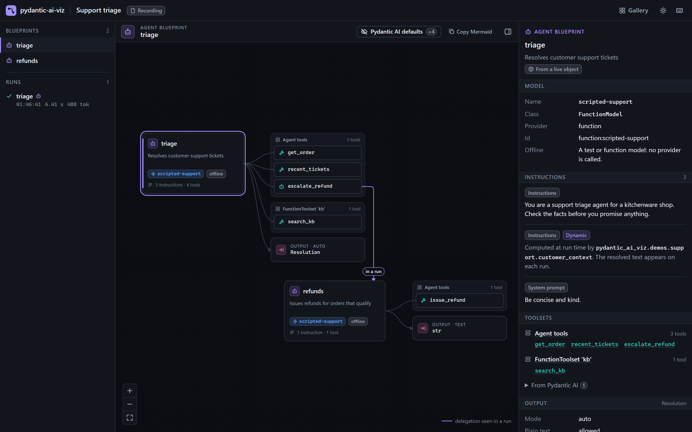

# Visualize an agent

A **blueprint** is a picture of what an agent *is*: its model, instructions, tools, output type and the agents it hands work to. `pydantic-ai-viz view` reads it from your source code, which is never executed; from Python it can also be read from the `Agent` object. Either way no agent is run, no model is called, and no API key is needed, so you can draw an agent that is configured for a provider you have no credentials for.

<figure class="screenshot" markdown="span">
  
  <figcaption><code>pydantic-ai-viz view src/pydantic_ai_viz/demos</code></figcaption>
</figure>

## From the command line

```bash
pydantic-ai-viz view TARGET...
```

| Target | What is drawn |
|---|---|
| `my_app/` | Every agent and graph in every `.py` file below that directory |
| `my_app/agents.py` | Every agent and graph in that file, including those made inside functions and classes |
| `my_app/agents.py:support_agent` | The agent assigned to `support_agent`, and the agents it delegates to |
| `my_app.agents`, `my_app.agents:support_agent` | The same, with the file found from the module name; nothing is imported to find it |
| `gh:owner/repo[@REF][/SUBDIR]`, or a `https://github.com/...` URL | A GitHub repository, fetched with `git` and read like a directory |

You can pass several targets. Imports between your own files are followed, so an agent in `agents.py` is drawn with the tools, output model and toolsets it imports from `tools.py` and `models.py`, and with the agents it delegates to wherever they live. The [CLI reference](../reference/cli.md#targets) has every form.

`view` **reads the source and never runs it**: nothing is imported, so it does not matter whether the dependencies are installed, and a script that calls its agent at the bottom is safe to view. What the code computes when it runs, such as `Agent(get_model())` or `Agent(os.getenv("MODEL"))`, is shown as that expression, marked "decided at run time", with a warning on the agent card. [How view works](../concepts/how-view-works.md) explains what can be read and what cannot.

`view` serves the viewer and opens your browser, and prints what it read:

```text
Read 11 files without running any code: 5 agents, 0 graphs; 5 warnings about what the source does not spell out (see the viewer)
```

To write a file instead:

```bash
pydantic-ai-viz view my_app/ --export blueprint.html
```

That produces a single HTML file containing only blueprints, which is safe to attach to a design document or a pull request: it holds no run data. All flags are in the [CLI reference](../reference/cli.md#view).

When the source does not say enough, `pydantic-ai-viz view --import my_app.agents:support_agent` imports the module and reads the live objects instead. That executes the module's code, so use it only on code you trust; see [When to use `--import`](../concepts/how-view-works.md#when-to-use-import).

## From Python

[`analyze`](../reference/python-api.md#analyze) reads source the way `view` does and returns the blueprints as data:

```python
import pydantic_ai_viz as pviz

found = pviz.analyze("my_app/")
for agent in found.agents:
    print(agent.label, agent.location, [tool.name for tool in agent.tools])
```

[`blueprint`](../reference/python-api.md#blueprint) returns the same structure from a live object, which you have imported yourself. It starts no server and no session:

```python
from my_app.agents import support_agent

bp = pviz.blueprint(support_agent)

print(bp.model.name if bp.model else "no model")
for tool in bp.tools:
    print(tool.name, "-", tool.description)
print(bp.warnings)  # anything that could not be read
```

The result is an [`AgentBlueprint`](../reference/python-api.md#agentblueprint) (or a [`GraphBlueprint`](../reference/python-api.md#graphblueprint) for a graph). Both are Pydantic models, so `bp.model_dump()` and `bp.model_dump_json()` work, which is handy for a snapshot test that fails when someone changes an agent's tools or output schema by accident. The fields are documented in the [wire format](../reference/wire-format.md#blueprints).

To open the picture from Python, use [`export_html`](../reference/python-api.md#export_html) with the agent itself, or [`serve`](../reference/python-api.md#serve):

```python
pviz.export_html(support_agent, "blueprint.html")
```

## Reading the canvas

<figure class="screenshot" markdown="span">
  
</figure>

Agent card

:   The agent's label and description, a chip with the model name, the number of instructions, and a warnings badge if something could not be read. Models from the `test` and `function` providers get an **offline** chip, so a diagram of a test setup is never mistaken for production.

    The label is the agent's `name`. An agent created without `name=` has none until its first run (Pydantic AI then infers it from the variable name), so the label falls back to the variable name when the agent was found in a module or file, and to `agent-1`, `agent-2`, ... otherwise.

Tool nodes

:   One node per function tool, grouped under a header for the toolset it belongs to: "Agent tools" for `@agent.tool` and `@agent.tool_plain`, and the toolset's own label for each `FunctionToolset`. Select a tool to see its description, parameter schema, return schema, whether it takes the run context, and its retry limit. Select a toolset's header to list its tools, each with its parameter count and the first line of its description; picking one there is the same as clicking it on the canvas.

Opaque toolsets

:   A toolset whose tools cannot be listed without running it (an MCP server, or a toolset built by a function at run time) is shown as one placeholder node marked "decided at run time". Its tools are added to the blueprint, marked as observed, as runs offer them to the model: the first run adds the ones it was given, and a later run adds any it was not.

Output node

:   The output mode (`text`, `tool`, `native`, `prompted` or `auto`) and the output type name. Select it for the JSON schema as a field table. Output tools such as `final_result` are part of this node, not tool nodes.

Delegation edges

:   An edge from a tool to another agent's card means "this tool runs that agent". The other agent is drawn in its own row underneath, one step to the right, with its own tools and output.

    - A **dashed** edge, labelled "in code", was found by reading the tool function's code. It is a good guess.
    - A **solid** edge, labelled "in a run", was seen happening in a run. It is a fact.

    See [Blueprint vs run](../concepts/blueprint-vs-run.md#evidence-on-delegation-edges) for how each is found.

The inspector on the right shows the details for whatever is selected, in sections one under the other. For an agent: warnings, model, instructions, toolsets, output, delegates, settings and capabilities. Capabilities that Pydantic AI adds to every agent are folded under a "built-in" disclosure. A blueprint read from source also says where each part is defined, as `file.py:line`, with a button that copies it.

On a blueprint, what you pick is kept in the page's address, so a link or a reload opens on the same agent, tool, toolset or graph node.

## What a blueprint cannot show

A blueprint is drawn without running an agent, so some things are out of reach by design. (A blueprint read from source has a few more gaps, each marked with a warning: see [what cannot be read](../concepts/how-view-works.md#what-shows-as-decided-at-run-time-and-why).)

- **The text of dynamic instructions.** A function decorated with `@agent.instructions` or `@agent.system_prompt` is listed by name, marked dynamic. Its output depends on the run; you see the resolved text on each run's model requests.
- **Tools of MCP and dynamic toolsets,** as described above.
- **Delegation that is not visible in the tool's code.** A blueprint read from source finds `await refunds_agent.run(...)` in a tool when `refunds_agent` can be traced to an agent: a variable of the module or of an enclosing scope, one imported from another file, an item of a dict or list written out in the source, or `ctx.deps.refunds` when the source shows the agent being passed as that dependency to `run`. It also finds an agent the tool hands to a function of your code that runs what it is given; an agent passed to anything else, such as a logging call, is not taken for a delegate. A blueprint read from a live object finds only module-level and enclosing-scope variables. Neither follows a helper function that picks and runs an agent of its own. Edges that were missed appear, solid, the first time the delegation runs.

When a blueprint is read from a live object, a handful of fields (instructions, system prompts, retry limits, output mode, native tools) have no public accessor in Pydantic AI and are read from private attributes. If a Pydantic AI release changes one, that field is left empty and a warning appears on the agent card. Nothing else is affected. The [compatibility page](../reference/compatibility.md#fields-read-from-private-attributes) lists them.

## Next

Blueprints become much more useful with runs on top: [Watch live runs](live-runs.md).
